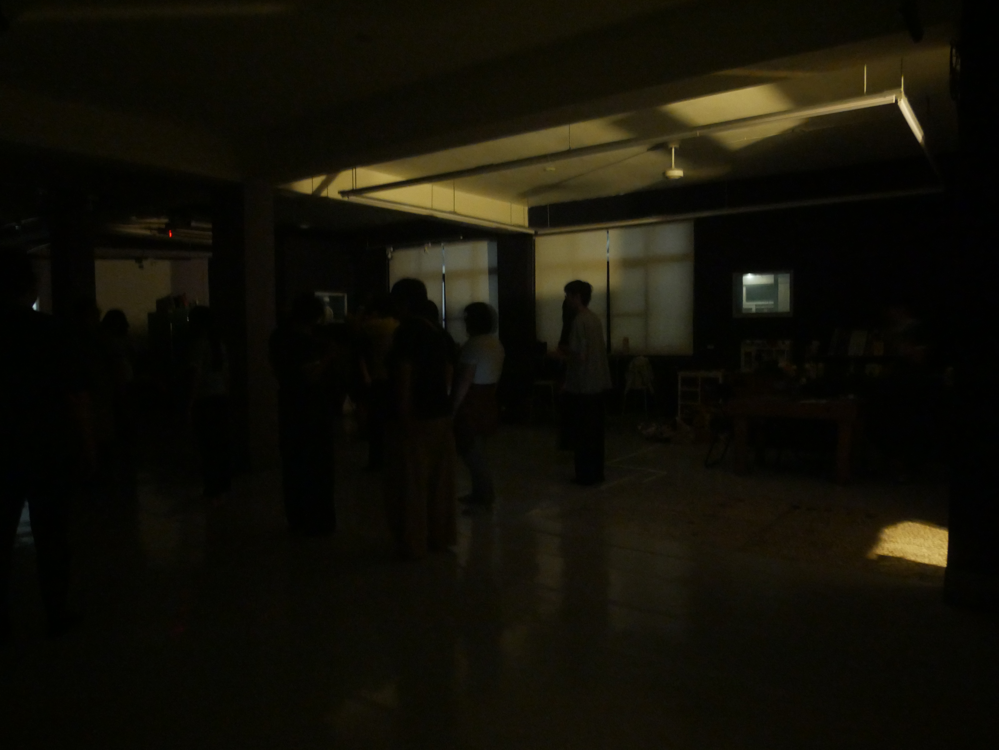
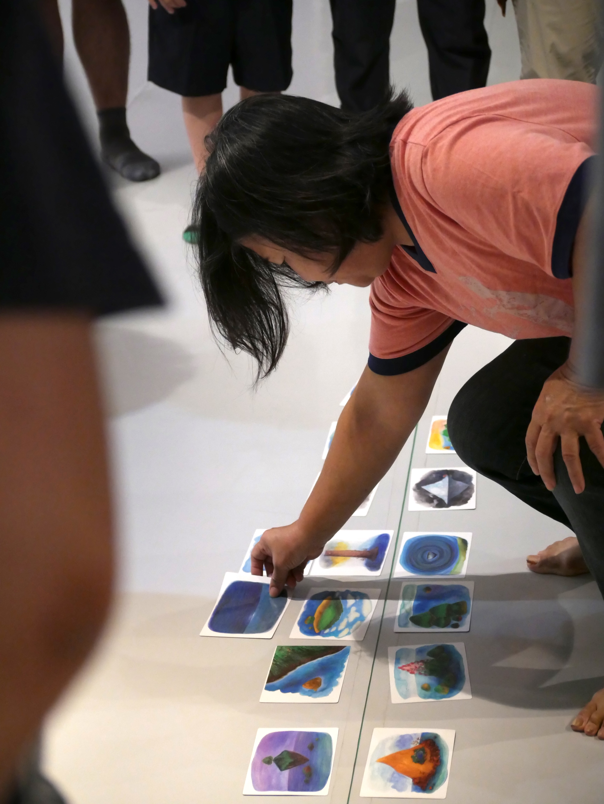
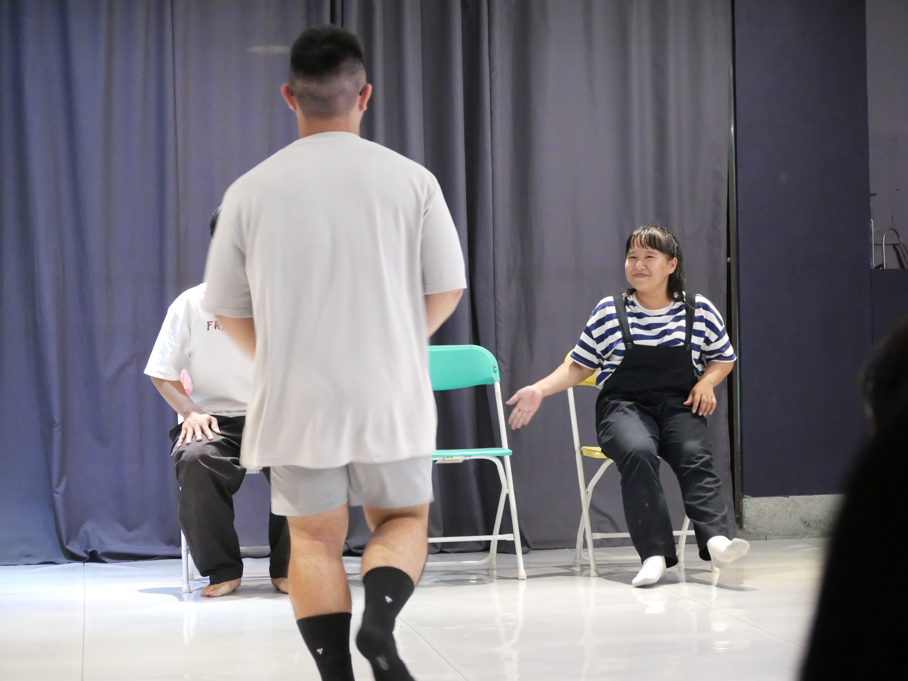
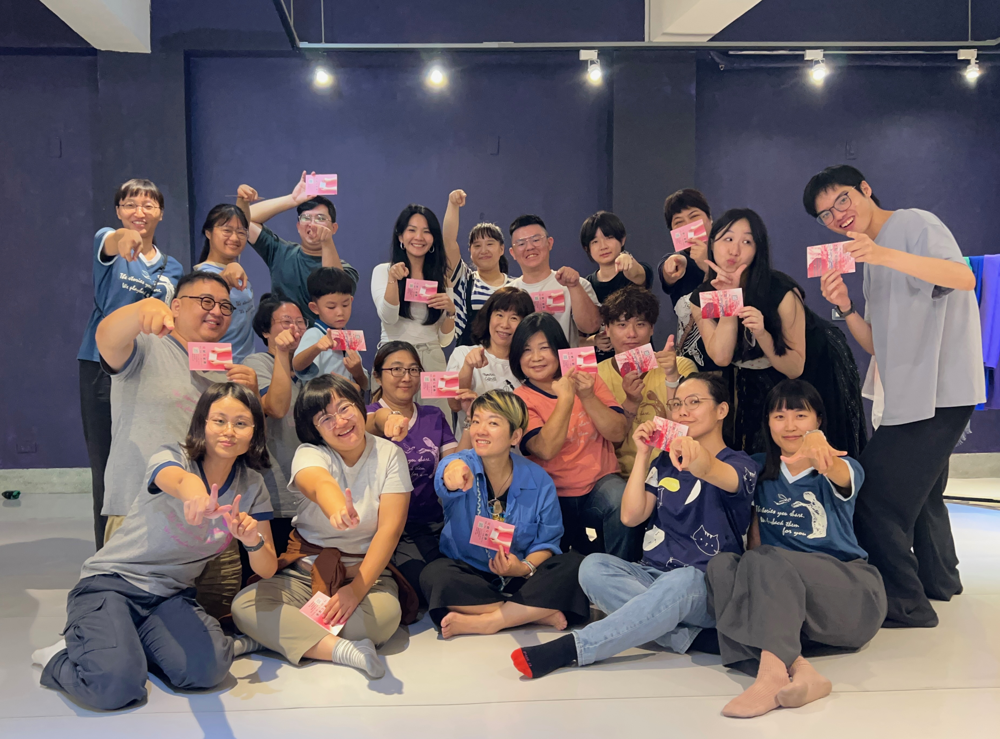

+++
date = '2026-11-06'
draft = false
title = '《青春期》開放團練'
private = true
categories= ["活動紀錄"]
tags = ["開放團練"]
keywords = ["一人一故事", "青春期", "開放團練", "台南"]
omit_header_text= false
featured_image = "group.jpg"
+++

這次的一人一故事開放團練由剛剛回歸的小武帶領，很歡迎十二位報名的朋友一起來練習。在短短的兩個小時內，我們一步步靠近青春期的身體記憶，然後以一人一故事的方式練習與服務彼此。

<!--more-->

*在漆黑中靠近自己的身體記憶*

在這次的暖身活動中，小武選擇將燈都關上，此時我們不需要眼睛，也不需要在意他人的視線，只要緩緩地跟著引導，專注於自己的身體，讓那些與自己青春期回憶、想法與感受自然而然地浮現......

*一起排列我們的青春期小島*

在另外一個暖身活動中，我們帶著代表自己青春期的小島，共同排列彼此的小島。無論是什麼樣的想法，在這裡都是被歡迎的。我們好像在這個過程中漸漸認識彼此，也漸漸信任彼此。

*小組練習裡的演出*

接著就進到「三段落」形式的練習了，每個人都有機會在小組裡練習說故事、下標題、傾聽故事核心，還有用演出來表達，好多的傾聽與演出回送在每一組的練習中悄悄發生著。

*新朋友們坦然地到演員的位置上練習*

最後，我們在練習布跟椅子的運用後，就進入到正式的三段落演出練習了。感謝試著上台分享故事的朋友們，也謝謝願意上台練習接下故事的朋友們，每一個故事我們都會好好珍惜，也讓我們從彼此身上學習到了好多。

*團練結束後的大合照與2027售票演出宣傳*

感謝這次願意一起來開放團練的新朋友舊朋友與我們的每一個青春期故事，也感謝剛回歸就帶領開放團練的小武，這也是南飛新團員們第一次看到小武兼具細膩與自由的主持風格，深受啟發外，也好像在一人一故事中更熟悉了彼此。

我們也期待之後有機會可以再看到這次一起團練的朋友們哦！

----

### 工商時間

再兩個月後就是2027售票演出了，地點一樣在瀞劇場，早鳥優惠到11/30為止！

#### 下午場《月來月有事》
是從生命裡知曉月經開始，在家庭和校園中遇到的故事來做演出。我們相信無論你是否有月經，都會有跟月經有關的故事。我們會以10歲以上孩子可以理解的方式進行，歡迎親子共同參與。（當然也可以大人自己來哦！）

#### 晚上場《代替月亮懲罰你》
我們會更深入月經在親密關係、職場與其他社會面向，講講那些我們長大後越來越明白、也或許是越來越不明白的故事，這一場演出為成人限定。

詳情請點[節目資訊與購票連結](https://forms.gle/hkTNY1tZjVWN13XLA) ，期待在劇場與您相見！